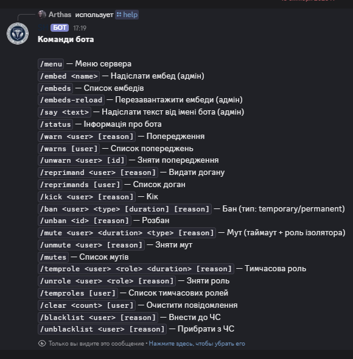

<div align="center">

# Sloboda Hospital — Main Discord Bot

The primary Discord bot for the Sloboda Hospital community.



</div>

## Overview

**SH** is the main bot of the project. Moderation toolkit, news publishing (`/post`), role system, JSON embed menus, error logging to a channel.

## Project Structure

```text
SH/
├── src/
│   ├── index.ts        Bot entry point
│   ├── config.ts       Configuration (env)
│   └── lib/            Helper modules (embeds, errors, notify, ...)
├── data/               Persistent project data
├── assets/             Images and media
├── package.json
└── tsconfig.json
```

## Tech Stack

- TypeScript 5.7
- Node.js
- discord.js 14.16
- dotenv
- tsc

## Purpose

Automation and support of the Sloboda Hospital Discord ecosystem: moderation, roles, news, informational menus.

---

<div align="center">

Built by **xeraze** for **Sloboda Hospital**

</div>